  

### `// about`

I write C at the systems level: processes, file descriptors, signals, memory and threads.
Trained at **42 Barcelona**, where everything is built from scratch, no libraries, no shortcuts, and every leak counts.

Before code I worked in visual design, which is why this page doesn't look like a default template.
Now I'm pointing all of it at **security**: understanding how systems work well enough to see how they break.

 

### `// path`

  

 

### `// projects`

| | project | what's under the hood |
|:--|:--|:--|
| `0x06` | [**minishell**](https://github.com/Leegon8/minishell) | A Bash-like shell: `fork` / `execve`, pipes, redirections, env expansion, signal handling and parsing raw user input. |
| `0x05` | [**Philosophers**](https://github.com/Leegon8/Philosophers) | The dining philosophers: threads, mutexes, race conditions and deadlock avoidance. |
| `0x04` | [**fract-ol**](https://github.com/Leegon8/fract-ol) | Mandelbrot & Julia fractals rendered in real time with MiniLibX. |
| `0x03` | [**minitalk**](https://github.com/Leegon8/minitalk) | Client ↔ server IPC using nothing but `SIGUSR1` and `SIGUSR2`, encoding messages bit by bit. |
| `0x02` | [**push_swap**](https://github.com/Leegon8/push_swap) | Sorting with two stacks and a limited instruction set, where every move counts. |
| `0x01` | [**get_next_line**](https://github.com/Leegon8/get_next_line) | Line-by-line reading from any fd with static buffers and zero leaks. |
| `0x00` | [**ft_printf**](https://github.com/Leegon8/ft_printf) | `printf` rebuilt from scratch: variadic arguments and format-string parsing. |

 

### `// toolkit`

  

 

### `// contact`

&nbsp;

 

<code>segfaults were harmed in the making of this profile.</code>

