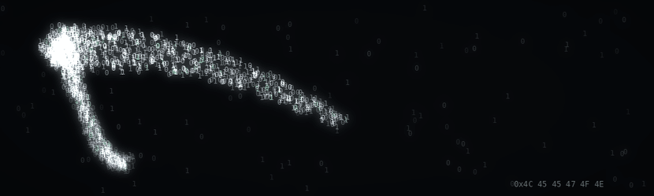

<p align="center">
  
</p>

```console
$ cat about.txt
```

I write C close to the metal: processes, file descriptors, signals, memory and threads.
Trained at **42 Barcelona**, where everything is built from scratch, no libraries, no shortcuts, and every leak counts.

Before code I worked in visual design, which is why this page doesn't look like a default template.
Now I'm pointing all of it at **security**: understanding how systems work well enough to see how they break.

<br>

```console
$ ls -l ~/projects
```

| project | what's under the hood |
|:--|:--|
| [**minishell**](https://github.com/Leegon8/minishell) | A Bash-like shell: `fork` / `execve`, pipes, redirections, env expansion, signal handling and parsing raw user input. |
| [**minitalk**](https://github.com/Leegon8/minitalk) | Client ↔ server IPC using nothing but `SIGUSR1` and `SIGUSR2`, encoding messages bit by bit. |
| [**Philosophers**](https://github.com/Leegon8/Philosophers) | The dining philosophers: threads, mutexes, race conditions and deadlock avoidance. |
| [**get_next_line**](https://github.com/Leegon8/get_next_line) | Line-by-line reading from any fd with static buffers and zero leaks. |
| [**ft_printf**](https://github.com/Leegon8/ft_printf) | `printf` rebuilt from scratch: variadic arguments and format-string parsing. |
| [**push_swap**](https://github.com/Leegon8/push_swap) | Sorting with two stacks and a limited instruction set, where every move counts. |
| [**fract-ol**](https://github.com/Leegon8/fract-ol) | Mandelbrot & Julia fractals rendered in real time with MiniLibX. |

<br>

```console
$ cat roadmap.md
```

- [x] C & Unix fundamentals (memory, processes, signals, concurrency)
- [ ] Linux & networking, deeper
- [ ] Hands-on labs (TryHackMe / Hack The Box)
- [ ] First CTF write-ups, published here

<br>

```console
$ which tools
```

<p>
  
  
  
  
  
  
  
</p>

<br>

```console
$ contact --now
```

[](https://www.linkedin.com/in/laurianegnr)
&nbsp;📍 Barcelona

<br>

<sub>`$ exit` · segfaults were harmed in the making of this profile.</sub>
